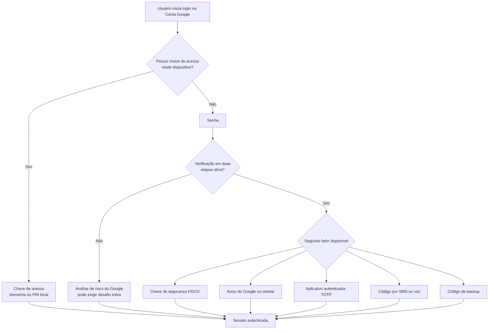

# Projeto 1.1: Um Estudo sobre os Métodos de Autenticação da Google

**Disciplina:** Segurança e Auditoria em TI (2026.2)
**Instituição:** Instituto Federal de Sergipe (IFS), Campus Itabaiana
**Professor:** Carlos Almeida
**Aluno:** Daniel Santos Lima

Estudo conceitual dos métodos de autenticação da Google: senhas, verificação em duas etapas (2SV), chaves de segurança, chaves de acesso e autenticação federada com OAuth 2.0, OpenID Connect e SAML 2.0.

## Resumo visual

| Método | Fator | Resiste a phishing | Custo | Indicado para |
|---|---|---|---|---|
| Senha | Conhecimento | Não | Nenhum | Nunca como único fator |
| SMS ou voz | Posse | Não | Nenhum | Apenas quando não há alternativa |
| Aplicativo autenticador (TOTP) | Posse | Não | Nenhum | Uso sem internet ou sem sinal |
| Aviso do Google | Posse | Em parte | Nenhum | Usuários em geral |
| Chave de segurança (FIDO2) | Posse | Sim | Compra das chaves | Administradores e áreas sensíveis |
| Chave de acesso (*passkey*) | Posse + biometria | Sim | Nenhum | Padrão recomendado para todos |

| Protocolo | Serve para | Uso na Google |
|---|---|---|
| OAuth 2.0 | Autorização delegada | Aplicativos que acessam APIs da Google |
| OpenID Connect | Autenticação | "Fazer login com o Google" |
| SAML 2.0 | SSO corporativo | Google Workspace com sistemas empresariais |



**Conclusão em uma frase:** só os métodos baseados em FIDO2 (chave de segurança e chave de acesso) resistem a phishing, e a conta é tão segura quanto o método mais fraco que continua habilitado.

## Estrutura do projeto

```
projeto-1.1-autenticacao-google/
├── README.md                 Este arquivo
├── docs/                     As seis atividades do enunciado
├── exemplos/                 Ativação da 2SV (com imagens) e fluxos OAuth 2.0 / OpenID Connect
├── diagramas/                Diagramas de fluxo (PNG)
├── relatorio-tecnico.md      Phishing, roubo de senhas e mitigação
├── artigo.md / artigo.docx   Artigo acadêmico
├── referencias.md            Fontes em formato ABNT
├── extras/                   Integração com FIDO2/WebAuthn e guia para usuários e pequenas empresas
└── apresentacao/             Slides do tópico 3.3 (Passkeys e WebAuthn)
```

## Como navegar

| Atividade do enunciado | Arquivo |
|---|---|
| 1. Definição do escopo | [docs/01-escopo.md](docs/01-escopo.md) |
| 2. Mecanismos de autenticação | [docs/02-mecanismos-de-autenticacao.md](docs/02-mecanismos-de-autenticacao.md) |
| 3. Protocolos federados | [docs/03-protocolos-federados.md](docs/03-protocolos-federados.md) |
| 4. Comparação e cenários de uso | [docs/04-comparacao-e-cenarios.md](docs/04-comparacao-e-cenarios.md) |
| 5. Políticas de acesso e melhores práticas | [docs/05-politicas-e-boas-praticas.md](docs/05-politicas-e-boas-praticas.md) |
| 6. Continuidade e redundância | [docs/06-continuidade-e-redundancia.md](docs/06-continuidade-e-redundancia.md) |

| Item de entrega | Arquivo |
|---|---|
| Imagens da ativação da 2SV | [exemplos/ativacao-2sv.md](exemplos/ativacao-2sv.md) |
| Exemplos de OAuth 2.0 e OpenID Connect | [exemplos/oauth2-e-openid-connect.md](exemplos/oauth2-e-openid-connect.md) |
| Diagramas de fluxo | [diagramas/](diagramas/) |
| Relatório técnico | [relatorio-tecnico.md](relatorio-tecnico.md) |
| Artigo acadêmico | [artigo.md](artigo.md) e [artigo.docx](artigo.docx) |
| Apresentação | [apresentacao/passkeys-e-webauthn.pptx](apresentacao/passkeys-e-webauthn.pptx) |

| Conteúdo adicional | Arquivo |
|---|---|
| Integração com FIDO2 e WebAuthn | [extras/passkeys-fido2-webauthn.md](extras/passkeys-fido2-webauthn.md) |
| Educação do usuário e adaptação para casas e pequenas empresas | [extras/guia-usuarios-e-pequenas-empresas.md](extras/guia-usuarios-e-pequenas-empresas.md) |

## Diagramas

| Nº | Diagrama |
|---|---|
| 1 | [Visão geral dos métodos de login](diagramas/01-visao-geral-metodos.png) |
| 2 | [Login com 2SV por aviso do Google](diagramas/02-fluxo-2sv.png) |
| 3 | [Login com chave de acesso (WebAuthn)](diagramas/03-passkey-webauthn.png) |
| 4 | [OAuth 2.0 com código de autorização e PKCE](diagramas/04-oauth2-authorization-code-pkce.png) |
| 5 | [Login com o Google via OpenID Connect](diagramas/05-openid-connect-login-google.png) |
| 6 | [SSO com SAML 2.0 no Google Workspace](diagramas/06-saml-sso-workspace.png) |
| 7 | [Recuperação de acesso e continuidade](diagramas/07-recuperacao-e-continuidade.png) |

## Guia para equipes de TI

### Dez ações prioritárias

1. Tornar a 2SV obrigatória para todos, com data anunciada e período de adesão.
2. Desativar SMS e chamada de voz como segundo fator.
3. Exigir chave de segurança, em duplicidade, de administradores e áreas sensíveis.
4. Incentivar chaves de acesso para os demais usuários.
5. Definir senha com mínimo de 12 caracteres, verificação de força e sem troca periódica.
6. Manter de dois a quatro superadministradores e uma conta de emergência fora do SSO.
7. Restringir aplicativos de terceiros nos controles de API.
8. Configurar SSO por SAML para os sistemas internos e controlar a validade dos certificados.
9. Verificar a identidade por canal independente antes de redefinir fatores de um usuário.
10. Monitorar os relatórios de segurança e treinar os usuários contra phishing a cada semestre.

### Política por perfil

| Perfil | Método obrigatório | Métodos proibidos |
|---|---|---|
| Superadministrador | Chave de segurança (duas) | Todos os demais |
| Financeiro, RH e diretoria | Chave de segurança ou chave de acesso | SMS e voz |
| Colaboradores | 2SV com aviso do Google, autenticador ou chave de acesso | SMS e voz |
| Terceiros e temporários | 2SV com autenticador | SMS e voz |

### Onde configurar no Admin Console

| Configuração | Caminho |
|---|---|
| Verificação em duas etapas | Segurança > Autenticação > Verificação em duas etapas |
| Política de senha | Segurança > Autenticação > Gerenciamento de senhas |
| Aplicativos de terceiros | Segurança > Controles de API |
| SSO com SAML | Apps > Apps da Web e para dispositivos móveis |
| Adesão à 2SV | Relatórios > Relatórios do usuário > Segurança |

O detalhamento das políticas está em [docs/05-politicas-e-boas-praticas.md](docs/05-politicas-e-boas-praticas.md), e os procedimentos de recuperação, em [docs/06-continuidade-e-redundancia.md](docs/06-continuidade-e-redundancia.md).
