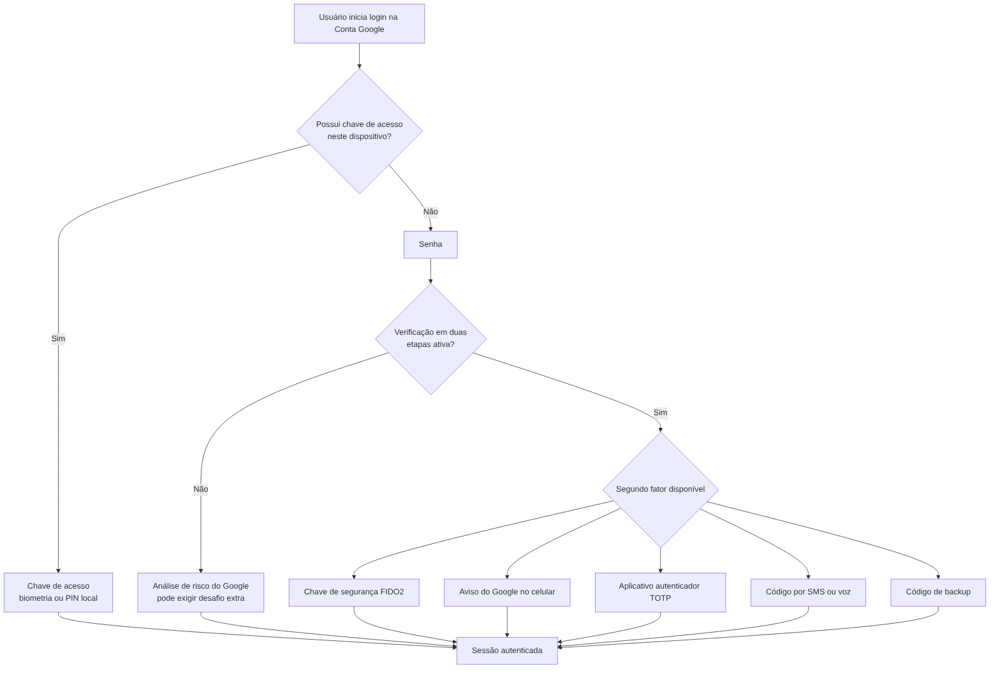

# 1. Definição do escopo

## 1.1 Objetivo

Este projeto analisa e documenta os métodos de autenticação oferecidos pela Google em contas pessoais (Conta Google) e corporativas (Google Workspace e Cloud Identity). O trabalho é conceitual: não há implementação de sistema, apenas estudo, comparação e recomendação.

O resultado serve a três públicos:

| Público | O que encontra aqui |
|---|---|
| Administradores de TI | Políticas de senha, implantação de 2SV, SSO com SAML e plano de continuidade |
| Usuários finais | Como proteger a própria conta e o que fazer ao perder o celular |
| Desenvolvedores | Como integrar "Fazer login com o Google" usando OAuth 2.0 e OpenID Connect com segurança |

## 1.2 Tecnologias analisadas

| Categoria | Tecnologia | Padrão ou norma de base | Onde está documentada |
|---|---|---|---|
| Fator de conhecimento | Senha tradicional | NIST SP 800-63B-4 | [02](02-mecanismos-de-autenticacao.md#21-senha-tradicional) |
| Segundo fator | Avisos do Google (prompts) | Proprietário da Google | [02](02-mecanismos-de-autenticacao.md#221-avisos-do-google-prompts) |
| Segundo fator | Código por SMS ou chamada de voz | Rede de telefonia (SS7) | [02](02-mecanismos-de-autenticacao.md#222-códigos-por-sms-ou-chamada-de-voz) |
| Segundo fator | Aplicativo autenticador | TOTP (RFC 6238) e HOTP (RFC 4226) | [02](02-mecanismos-de-autenticacao.md#223-aplicativos-autenticadores-totp) |
| Segundo fator | Chave de segurança física | FIDO U2F, FIDO2 (CTAP + WebAuthn) | [02](02-mecanismos-de-autenticacao.md#224-chaves-de-segurança-físicas) |
| Segundo fator | Códigos de backup | Proprietário da Google | [02](02-mecanismos-de-autenticacao.md#225-códigos-de-backup) |
| Sem senha | Chaves de acesso (passkeys) com biometria | FIDO2 / W3C WebAuthn | [02](02-mecanismos-de-autenticacao.md#23-chaves-de-acesso-passkeys) |
| Federação | Login com a Conta Google em terceiros | OAuth 2.0 + OpenID Connect | [02](02-mecanismos-de-autenticacao.md#24-login-com-a-conta-google-em-serviços-de-terceiros) |
| Protocolo | OAuth 2.0 | RFC 6749, RFC 6750, RFC 7636, RFC 9700 | [03](03-protocolos-federados.md#31-oauth-20) |
| Protocolo | OpenID Connect | OpenID Connect Core 1.0 | [03](03-protocolos-federados.md#32-openid-connect-oidc) |
| Protocolo | SAML 2.0 | OASIS SAML 2.0 | [03](03-protocolos-federados.md#33-saml-20) |

## 1.3 Fora do escopo

- Autenticação de máquinas e cargas de trabalho no Google Cloud (contas de serviço, Workload Identity Federation).
- Autorização fina dentro do Google Cloud (papéis e políticas de IAM).
- Implementação de um provedor de identidade próprio.
- Testes de intrusão contra contas reais.

## 1.4 Conceitos usados no restante do trabalho

**Autenticação** é o processo de provar que alguém é quem diz ser. **Autorização** é decidir o que essa identidade pode fazer. A confusão entre as duas é comum: o OAuth 2.0, por exemplo, trata de autorização, e só passa a servir para autenticação quando combinado com o OpenID Connect.

Os fatores de autenticação se dividem em três grupos:

| Fator | Significado | Exemplos na Google |
|---|---|---|
| Conhecimento | Algo que a pessoa sabe | Senha, PIN |
| Posse | Algo que a pessoa tem | Celular, chave de segurança, códigos de backup impressos |
| Inerência | Algo que a pessoa é | Impressão digital ou rosto, usados para destravar a chave de acesso |

A Google chama de **verificação em duas etapas** (2SV, de *2-Step Verification*) o que a literatura chama de autenticação de dois fatores (2FA). Autenticação multifator (MFA) é o termo geral para dois ou mais fatores.

Um método é **resistente a phishing** quando, mesmo que o usuário seja enganado e acesse um site falso, o atacante não consegue obter nada que sirva para entrar na conta verdadeira. Esse é o critério mais importante da comparação feita no [documento 04](04-comparacao-e-cenarios.md).

A visão geral do processo de login está no diagrama abaixo.

## 1.5 Método de trabalho

1. Levantamento da documentação oficial da Google (Central de Ajuda da Conta Google, Ajuda do Admin do Google Workspace e Google Identity para desenvolvedores).
2. Leitura dos padrões abertos em que cada método se apoia (RFCs do IETF, especificações da OpenID Foundation, OASIS, W3C e FIDO Alliance).
3. Confronto com normas de boas práticas (NIST SP 800-63B-4, ABNT NBR ISO/IEC 27001 e 27002, OWASP).
4. Comparação dos métodos por critérios fixos de segurança, usabilidade e custo.
5. Elaboração das recomendações por público e do plano de continuidade.

A lista completa de fontes está em [referencias.md](../referencias.md).
