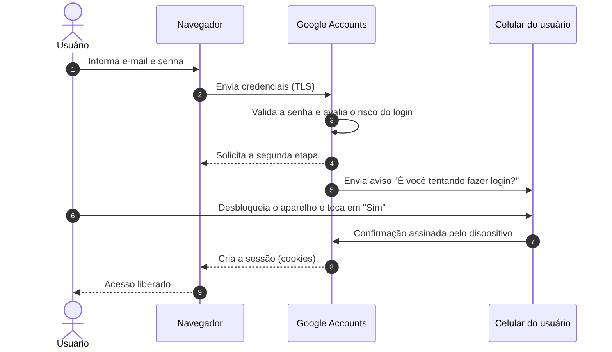
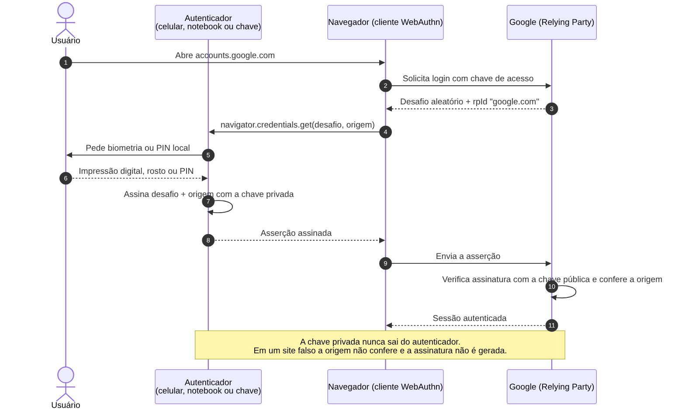

# 2. Mecanismos de autenticação da Google

## 2.1 Senha tradicional

A senha continua sendo o método mais comum e também o mais atacado. Ela é um segredo compartilhado: o usuário conhece a senha e o servidor guarda uma forma derivada dela (um *hash* com sal). Qualquer pessoa que descubra o segredo passa a ter o mesmo poder do dono da conta.

### Principais ameaças

| Ameaça | Como funciona |
|---|---|
| Phishing | Página falsa imita o login do Google e captura a senha digitada |
| *Credential stuffing* | Senhas vazadas de outros sites são testadas em massa, explorando a reutilização |
| Força bruta e dicionário | Tentativas automáticas com senhas comuns ou previsíveis |
| *Malware* (keylogger, infostealer) | Programa malicioso registra o que é digitado ou rouba senhas salvas |
| Engenharia social | O atacante convence a vítima, ou o suporte, a revelar ou redefinir a senha |

### Boas práticas de força

As recomendações seguem a NIST SP 800-63B-4, publicada em 2025, que mudou orientações antigas ainda presentes em muitas políticas corporativas.

| Prática | Recomendação atual | Motivo |
|---|---|---|
| Comprimento | Mínimo de 15 caracteres quando a senha é o único fator; mínimo de 8 quando há segundo fator. Aceitar pelo menos 64 | O comprimento contribui mais para a força do que a variedade de símbolos |
| Regras de composição | Não exigir maiúscula, número e símbolo obrigatórios | Geram padrões previsíveis como `Senha@2026` |
| Frases-senha | Preferir várias palavras aleatórias, por exemplo `cavalo-nuvem-tijolo-lanterna` | Longas e mais fáceis de lembrar |
| Lista de bloqueio | Recusar senhas comuns ou presentes em vazamentos | Elimina as primeiras tentativas de qualquer atacante |
| Unicidade | Uma senha diferente para cada serviço | Impede que um vazamento comprometa outras contas |
| Gerenciador de senhas | Usar o Gerenciador de senhas do Google ou outro de confiança | Viabiliza senhas longas e únicas |
| Troca periódica | Não obrigar troca por calendário; trocar apenas se houver indício de comprometimento | Trocas forçadas levam a variações fracas da senha anterior |

### O que a Google oferece

- Exigência mínima de 8 caracteres em contas pessoais e bloqueio de senhas muito fracas.
- **Gerenciador de senhas do Google**, integrado ao Chrome e ao Android, com geração de senhas fortes.
- **Check-up de senhas**, que avisa quando uma senha salva apareceu em vazamento, é fraca ou está repetida.
- **Análise de risco no login**: mesmo sem 2SV, um acesso vindo de aparelho ou local incomum pode receber um desafio adicional.
- No Google Workspace, o administrador define comprimento mínimo e máximo (de 8 a 100 caracteres), aplica verificação de força, impede reutilização e pode configurar expiração.

## 2.2 Verificação em duas etapas (2SV)

Com a 2SV ativa, depois da senha o Google exige uma segunda prova, em geral ligada a algo que o usuário possui. O fluxo com aviso no celular é mostrado a seguir.



O passo a passo de ativação, com ilustrações, está em [exemplos/ativacao-2sv.md](../exemplos/ativacao-2sv.md).

### 2.2.1 Avisos do Google (prompts)

O Google envia uma notificação para os celulares em que a conta está logada (Android, ou iPhone com os aplicativos Google ou Gmail). A tela mostra o aparelho, o local aproximado e o horário da tentativa, e o usuário toca em **Sim** ou **Não**. Em situações de maior risco, o aviso pede que o usuário escolha no celular o número exibido na tela do computador.

- **Vantagens:** rápido, sem digitação, não depende da operadora e resiste à troca de chip (*SIM swap*). É o segundo fator que a Google recomenda para quem não usa chave de acesso.
- **Limitações:** exige internet no celular. Está sujeito à **fadiga de MFA**, em que o atacante dispara pedidos repetidos até a vítima aprovar por cansaço, e a phishing em tempo real, em que a vítima aprova um login iniciado pelo atacante.

### 2.2.2 Códigos por SMS ou chamada de voz

O Google envia um código numérico de uso único para o telefone cadastrado.

- **Vantagens:** funciona em qualquer celular, sem aplicativo e sem internet. É melhor do que usar apenas senha.
- **Limitações:** é o segundo fator mais fraco. O código pode ser obtido por *SIM swap*, por interceptação na rede de telefonia (falhas do protocolo SS7), por *malware* que lê mensagens ou por engenharia social ("me passe o código que você acabou de receber"). Depende de sinal da operadora.

Em 2025 a Google declarou a intenção de reduzir o uso de códigos por SMS, substituindo-os por leitura de código QR com a câmera do celular, justamente por causa dessas fraquezas. A NIST SP 800-63B-4 classifica o envio pela rede telefônica como autenticador de uso restrito.

### 2.2.3 Aplicativos autenticadores (TOTP)

Aplicativos como o Google Authenticator geram códigos de 6 dígitos que mudam a cada 30 segundos, seguindo o padrão TOTP (RFC 6238). Na configuração, o Google mostra um código QR com um segredo, que fica guardado no aplicativo. A partir daí, aplicativo e servidor calculam o mesmo código de forma independente:

```
código = Truncar( HMAC-SHA1( segredo, ⌊tempo_unix / 30⌋ ) ) mod 10^6
```

- **Vantagens:** funciona sem internet e sem operadora, não sofre *SIM swap* e é um padrão aberto aceito por muitos serviços.
- **Limitações:** o código ainda pode ser digitado em um site falso e repassado em tempo real ao site verdadeiro. Se o celular for perdido sem cópia do segredo, o acesso se perde. O Google Authenticator permite sincronizar os códigos com a Conta Google, o que resolve a perda do aparelho, mas torna a segurança dos códigos dependente da própria conta.

### 2.2.4 Chaves de segurança físicas

São dispositivos USB, NFC ou Bluetooth, como a Titan Security Key da Google e as YubiKeys, que implementam os padrões FIDO U2F e FIDO2. No cadastro, a chave cria um par de chaves criptográficas exclusivo para o site e entrega ao Google apenas a chave pública. No login, o navegador repassa à chave um desafio junto com a **origem** do site, e a chave só assina se a origem for a mesma do cadastro.

- **Vantagens:** é o segundo fator mais forte. Por estar vinculado à origem, resiste a phishing: em `accounts-google.exemplo.com` a chave simplesmente não responde. Não há código para digitar ou repassar, e a chave privada não pode ser extraída.
- **Limitações:** tem custo de aquisição, pode ser perdida e exige uma segunda chave de reserva. Alguns aparelhos antigos não têm suporte.

A Google informou que, após adotar chaves de segurança para todos os seus mais de 85 mil funcionários em 2017, não registrou novas contas comprometidas por phishing (KREBS, 2018).

**Uso em ambiente corporativo.** No Google Workspace, o administrador pode:

1. Tornar a 2SV obrigatória por unidade organizacional, com prazo de adesão para novos usuários.
2. Restringir os métodos aceitos a **somente chave de segurança** para grupos sensíveis (administradores, financeiro, diretoria).
3. Distribuir duas chaves por pessoa (uma de uso diário e uma reserva guardada em local seguro) e registrar os números de série no inventário.
4. Definir um período de tolerância para uso de códigos de backup gerados pelo administrador quando a chave é perdida.
5. Inscrever contas de alto risco no **Programa Proteção Avançada**, que exige chave de segurança ou chave de acesso e limita o acesso de aplicativos de terceiros aos dados.

### 2.2.5 Códigos de backup

O Google gera um conjunto de 10 códigos de 8 dígitos. Cada código funciona uma única vez e um novo conjunto pode ser gerado a qualquer momento, o que invalida o anterior.

- **Vantagens:** independem de celular, bateria e internet. São o recurso de última instância.
- **Limitações:** são segredos estáticos. Se forem fotografados, guardados em e-mail ou digitados em site falso, podem ser usados por terceiros. Devem ficar impressos em local seguro ou em gerenciador de senhas, nunca em arquivo de texto na área de trabalho.

## 2.3 Chaves de acesso (passkeys)

As chaves de acesso substituem a senha. São credenciais FIDO2/WebAuthn guardadas no celular, no computador, em um gerenciador de senhas ou em uma chave de segurança. Para usar, a pessoa apenas desbloqueia o dispositivo com impressão digital, reconhecimento facial ou PIN.



Três pontos explicam a segurança do método:

1. **Criptografia assimétrica.** O Google guarda só a chave pública. Um vazamento do banco de dados do servidor não expõe nada que permita entrar na conta.
2. **Vínculo com a origem.** A assinatura inclui o domínio real do site. Em uma página falsa, a chave de acesso não é oferecida ou a assinatura não é aceita.
3. **Verificação local do usuário.** A biometria ou o PIN ficam no aparelho e servem apenas para liberar o uso da chave privada. Nenhum dado biométrico é enviado ao Google.

Como a chave de acesso combina posse (o dispositivo) com inerência ou conhecimento (biometria ou PIN), ela já equivale a dois fatores, e por isso o Google dispensa a segunda etapa quando ela é usada.

Existem dois tipos:

| Tipo | Onde fica | Característica |
|---|---|---|
| Sincronizada | Gerenciador de senhas do Google, iCloud Keychain e similares | Disponível em todos os aparelhos da pessoa e recuperável se um deles for perdido |
| Vinculada ao dispositivo | Chave de segurança física ou módulo seguro do aparelho | Não pode ser copiada; maior garantia, porém exige reserva |

A Google lançou as chaves de acesso para contas pessoais em maio de 2023 e, em outubro do mesmo ano, passou a oferecê-las como opção padrão de login. Para usar uma chave de acesso do celular em um computador de terceiros, o computador mostra um código QR e a conexão é confirmada por proximidade via Bluetooth, o que impede que um atacante distante aproveite o código.

- **Vantagens:** resistência a phishing, nada para memorizar ou digitar, login mais rápido que senha com 2SV.
- **Limitações:** dependem do ecossistema que as sincroniza. A senha e os métodos antigos costumam continuar ativos na conta como alternativa, e por isso também precisam ser protegidos. A recuperação exige planejamento (ver [documento 06](06-continuidade-e-redundancia.md)).

## 2.4 Login com a Conta Google em serviços de terceiros

O botão "Fazer login com o Google" permite que um site use a Conta Google como identidade, sem criar uma senha nova. Do ponto de vista técnico, é o OpenID Connect sobre OAuth 2.0, descrito no [documento 03](03-protocolos-federados.md). A Google disponibiliza a biblioteca Google Identity Services, que inclui o botão e o login com um toque (*One Tap*).

- **Vantagens para o usuário:** menos senhas para criar e lembrar. O site herda a proteção da Conta Google (2SV, chaves de acesso, detecção de login suspeito).
- **Vantagens para o site:** não armazena senhas e reduz o risco em caso de vazamento.
- **Riscos:** a Conta Google passa a ser um ponto único de falha, e comprometê-la dá acesso a todos os serviços ligados. Há também o **phishing de consentimento**, em que um aplicativo malicioso pede permissões amplas pela tela legítima do Google. O usuário deve revisar periodicamente os acessos de terceiros em `myaccount.google.com/connections`.

## 2.5 Resumo

| Método | Fator | Resiste a phishing? | Depende de |
|---|---|---|---|
| Senha | Conhecimento | Não | Memória ou gerenciador |
| Aviso do Google | Posse | Parcialmente | Celular com internet |
| SMS ou voz | Posse | Não | Operadora |
| Aplicativo autenticador | Posse | Não | Celular |
| Código de backup | Posse | Não | Papel ou cofre |
| Chave de segurança | Posse | Sim | Dispositivo físico |
| Chave de acesso | Posse + inerência | Sim | Dispositivo com bloqueio de tela |

A comparação completa, com justificativas e cenários, está no [documento 04](04-comparacao-e-cenarios.md).
