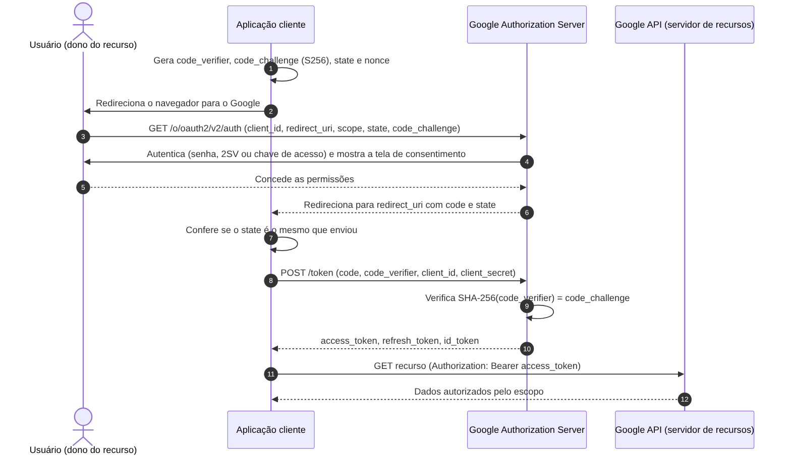
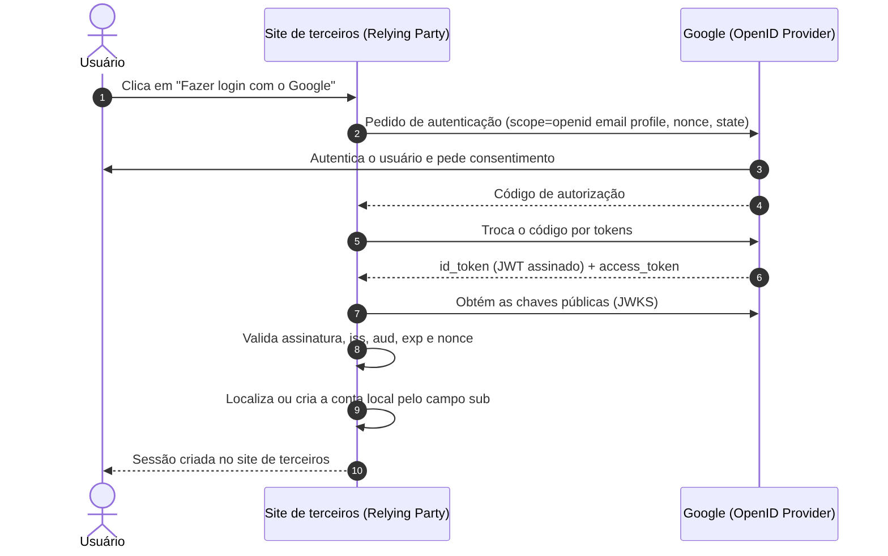
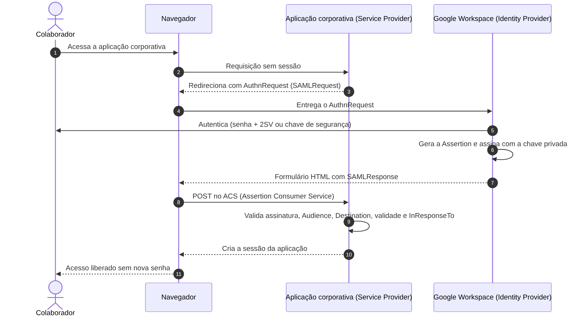

# 3. Protocolos de identidade federada

Identidade federada é o arranjo em que um sistema confia na autenticação feita por outro. O sistema que autentica é o **provedor de identidade** (IdP) e o que consome o resultado é o **provedor de serviço** (SP) ou a **parte confiante** (RP, de *Relying Party*). A Google atua nos dois papéis: é IdP quando alguém usa "Fazer login com o Google", e pode ser SP quando uma empresa configura o Workspace para autenticar em outro IdP.

| Protocolo | Finalidade | Formato | Uso típico na Google |
|---|---|---|---|
| OAuth 2.0 | Autorização delegada | Tokens de acesso, JSON | Aplicativo acessa Drive, Agenda ou Gmail em nome do usuário |
| OpenID Connect | Autenticação sobre OAuth 2.0 | ID token em JWT | "Fazer login com o Google" |
| SAML 2.0 | Autenticação e SSO corporativo | Asserções em XML | SSO entre Google Workspace e aplicações empresariais |

## 3.1 OAuth 2.0

O OAuth 2.0 (RFC 6749) permite que um aplicativo acesse recursos de um usuário sem conhecer a senha dele. Em vez da senha, o aplicativo recebe um **token de acesso** com permissões limitadas (**escopos**) e validade curta.

### Papéis

| Papel | Quem é no caso da Google |
|---|---|
| Dono do recurso | O usuário da Conta Google |
| Cliente | O aplicativo de terceiros, registrado no Google Cloud Console |
| Servidor de autorização | `accounts.google.com` e `oauth2.googleapis.com` |
| Servidor de recursos | As APIs da Google (Drive, Agenda, Gmail etc.) |

### Fluxo de código de autorização com PKCE

É o fluxo recomendado para aplicações web, móveis e de página única.

O PKCE (RFC 7636) protege contra a interceptação do código de autorização. O cliente cria um valor aleatório (`code_verifier`), envia apenas o *hash* dele (`code_challenge`) no início e revela o valor original somente na troca do código por tokens. Quem interceptar o código no meio do caminho não consegue trocá-lo, pois não conhece o `code_verifier`.

As requisições completas, com os endereços reais da Google, estão em [exemplos/oauth2-e-openid-connect.md](../exemplos/oauth2-e-openid-connect.md).

### Tokens

| Token | Função | Validade na Google | Cuidados |
|---|---|---|---|
| Código de autorização | Credencial intermediária trocada por tokens | Minutos, uso único | Só trafega pelo navegador; nunca reutilizar |
| Token de acesso | Enviado às APIs no cabeçalho `Authorization: Bearer` | Cerca de 1 hora | Guardar em memória; nunca em URL |
| Token de atualização | Obtém novos tokens de acesso sem nova interação | Longa duração, até ser revogado | Guardar cifrado no servidor; revogar ao sair |
| ID token | Prova de autenticação (OpenID Connect) | Cerca de 1 hora | Validar assinatura e declarações |

### Outros fluxos

| Fluxo | Situação | Observação |
|---|---|---|
| Dispositivo (RFC 8628) | TVs e aparelhos sem teclado | O usuário digita um código curto em outro dispositivo |
| Credenciais do cliente e contas de serviço | Servidor para servidor | Não há usuário envolvido |
| Implícito | Legado | Proibido pela RFC 9700, pois expõe o token na URL |
| Senha do dono do recurso | Legado | Proibido pela RFC 9700, pois entrega a senha ao aplicativo |

### Segurança e boas práticas

As recomendações abaixo vêm da RFC 9700 (*Best Current Practice for OAuth 2.0 Security*, 2025) e das políticas da Google.

| Risco | Medida |
|---|---|
| Interceptação do código de autorização | PKCE com método `S256` em todos os clientes |
| CSRF no retorno | Parâmetro `state` aleatório, vinculado à sessão e conferido na volta |
| Redirecionamento aberto | Cadastrar `redirect_uri` exatas, com HTTPS, sem curingas |
| Vazamento de token | Não usar o fluxo implícito; não colocar tokens em URL ou em registros |
| Permissão excessiva | Pedir o menor conjunto de escopos, de forma incremental, só quando a função for usada |
| Roubo do token de atualização | Armazenar cifrado no servidor, usar rotação e revogar em caso de suspeita |
| Segredo do cliente exposto | Nunca embutir `client_secret` em aplicativo móvel ou JavaScript; usar cofre de segredos |
| Aplicativo móvel com navegador embutido | Usar o navegador do sistema (RFC 8252). A Google bloqueia *webviews* embutidas |
| Phishing de consentimento | Passar pela verificação de aplicativo da Google. No Workspace, o administrador restringe aplicativos de terceiros |

## 3.2 OpenID Connect (OIDC)

O OAuth 2.0 sozinho diz o que o aplicativo pode acessar, mas não diz quem é o usuário. O OpenID Connect acrescenta essa camada: quando o escopo `openid` é solicitado, o Google devolve também um **ID token**, um JWT assinado com informações sobre a autenticação.

### Declarações do ID token

| Campo | Significado | Verificação obrigatória |
|---|---|---|
| `iss` | Emissor | Deve ser `https://accounts.google.com` |
| `aud` | Destinatário | Deve ser o `client_id` do aplicativo |
| `sub` | Identificador único e estável do usuário | Usar como chave da conta local |
| `exp`, `iat` | Expiração e emissão | Rejeitar token vencido |
| `nonce` | Valor enviado pelo aplicativo no pedido | Deve ser igual ao enviado, para evitar repetição |
| `email`, `email_verified` | E-mail e indicação de verificação | Não usar o e-mail como identificador principal |
| `hd` | Domínio do Workspace | Conferir quando o acesso é restrito a uma organização |

A assinatura é validada com as chaves públicas divulgadas no documento de descoberta da Google (`https://accounts.google.com/.well-known/openid-configuration`), que aponta para o endereço do conjunto de chaves (JWKS). As chaves são trocadas periodicamente, e por isso o aplicativo deve buscá-las dinamicamente e respeitar o cache indicado.

Um ID token decodificado e a lista de verificações estão em [exemplos/oauth2-e-openid-connect.md](../exemplos/oauth2-e-openid-connect.md#parte-2-openid-connect-e-validação-do-id-token).

### Erros comuns de implementação

- Aceitar o ID token sem validar a assinatura ou o campo `aud`. Um token emitido para outro aplicativo seria aceito.
- Identificar o usuário pelo `email`. O e-mail pode mudar ou ser reatribuído, enquanto o `sub` é permanente.
- Usar o token de acesso como prova de identidade. Ele serve para chamar APIs, não para autenticar.
- Confiar no campo `hd` enviado no pedido sem conferi-lo no token recebido.

## 3.3 SAML 2.0

O SAML 2.0 é um padrão da OASIS, de 2005, baseado em XML e muito usado para *single sign-on* (SSO) corporativo. O IdP emite uma **asserção** assinada digitalmente, que afirma quem é o usuário, e o SP confia nela.

No Google Workspace há dois cenários:

| Cenário | Papel da Google | Exemplo |
|---|---|---|
| Google como IdP | Autentica o colaborador e emite a asserção | Colaborador entra em um ERP ou sistema de chamados com a conta do Workspace |
| Google como SP | Recebe a asserção de um IdP externo | Empresa que já usa Microsoft Entra ID ou Okta e quer acessar o Gmail com a mesma identidade |

### Uso seguro do SAML

| Risco | Medida |
|---|---|
| Asserção forjada ou alterada | Validar a assinatura XML com o certificado do IdP e exigir assinatura na asserção |
| *XML Signature Wrapping* | Usar bibliotecas atualizadas e validar exatamente o elemento assinado |
| Repetição de asserção | Conferir `NotBefore` e `NotOnOrAfter`, guardar IDs já usados e validar `InResponseTo` |
| Asserção destinada a outro SP | Conferir `Audience` e `Destination` |
| Certificado vencido ou comprometido | Controlar a validade e planejar a rotação do certificado |
| Interceptação | Usar HTTPS em todos os pontos |
| IdP externo fora do ar | Manter uma conta de superadministrador que entra direto no Google, sem SSO, protegida por chave de segurança |

## 3.4 Qual protocolo usar

| Necessidade | Protocolo indicado | Justificativa |
|---|---|---|
| Aplicativo precisa ler ou alterar dados do usuário em APIs da Google | OAuth 2.0 | É o protocolo de autorização delegada, com escopos |
| Site ou aplicativo quer apenas autenticar pessoas com a Conta Google | OpenID Connect | Simples, baseado em JSON e adequado a web e dispositivos móveis |
| Empresa quer SSO entre o Workspace e sistemas corporativos | SAML 2.0 | Amplo suporte em software empresarial e controle centralizado |
| Aplicação nova que aceita os dois | OpenID Connect | Mais simples de implementar e de validar que XML assinado |
