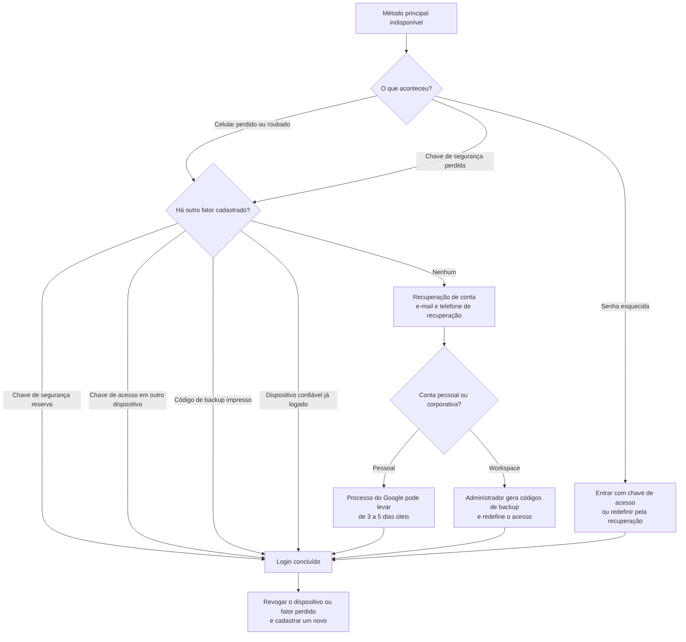

# 6. Continuidade e redundância

Quanto mais forte a autenticação, maior o risco de o próprio dono ficar sem acesso. Um plano de continuidade busca garantir a **disponibilidade** sem criar atalhos que um atacante também possa usar. O princípio é simples: nenhuma conta deve depender de um único fator ou de um único dispositivo.

## 6.1 Métodos alternativos de login

| Método alternativo | Quando usar | Cuidados |
|---|---|---|
| Segunda chave de segurança | Perda ou defeito da chave principal | Guardar em local diferente da principal (cofre, casa) |
| Chave de acesso em outro dispositivo | Perda do celular | Cadastrar chaves de acesso em pelo menos dois aparelhos, ou usar chave sincronizada |
| Códigos de backup | Sem celular e sem chave | Imprimir e guardar; gerar novo conjunto depois de usar |
| Aplicativo autenticador em segundo aparelho | Troca ou perda do celular | Transferir as contas antes de formatar o aparelho antigo |
| Dispositivo confiável já logado | Qualquer falha do segundo fator | Usar a sessão ativa para cadastrar um novo fator |
| Telefone e e-mail de recuperação | Último recurso antes do suporte | Manter atualizados; o e-mail de recuperação também deve ter 2SV |
| Contatos de recuperação | Conta pessoal sem outro meio | Escolher pessoas de confiança, se o recurso estiver disponível na conta |
| Administrador do Workspace | Conta corporativa bloqueada | Só após confirmar a identidade do solicitante |

## 6.2 Fluxo de decisão

## 6.3 Procedimentos por cenário

### Celular perdido ou roubado

1. Entrar na conta por outro meio: chave de acesso em outro dispositivo, chave de segurança, código de backup ou computador já logado.
2. Em `myaccount.google.com/device-activity`, encerrar a sessão do aparelho perdido.
3. Usar o serviço **Localizar meu dispositivo** para bloquear ou apagar o aparelho.
4. Remover as chaves de acesso e o autenticador ligados ao aparelho e trocar a senha.
5. Pedir à operadora o bloqueio do chip e a segunda via do número.
6. Cadastrar os fatores no novo aparelho e gerar novos códigos de backup.

### Chave de segurança perdida

1. Entrar com a chave reserva ou com outro fator.
2. Remover a chave perdida da conta.
3. Adquirir e cadastrar uma nova chave reserva.

Em contas do Programa Proteção Avançada, somente outra chave de segurança ou chave de acesso é aceita. Sem ela, a recuperação passa por um processo de verificação da Google que pode levar alguns dias.

### Senha esquecida

1. Entrar com chave de acesso, se houver.
2. Caso contrário, usar a opção "Esqueceu a senha?" e seguir a recuperação com os fatores cadastrados.
3. Criar uma senha nova e única, e salvá-la no gerenciador.

### Conta comprometida

1. Acessar `accounts.google.com/signin/recovery` e recuperar o controle.
2. Trocar a senha e encerrar todas as outras sessões.
3. Revisar e remover: fatores desconhecidos, telefones e e-mails de recuperação alterados, aplicativos de terceiros, regras de encaminhamento e filtros do Gmail.
4. Executar a Verificação de segurança da conta.
5. No ambiente corporativo, registrar o incidente e comunicar a equipe de segurança.

### Usuário corporativo bloqueado (procedimento da TI)

1. Confirmar a identidade do solicitante por um canal independente, como videochamada, presença física ou confirmação do gestor. Nunca aceitar apenas um e-mail ou uma mensagem.
2. No Admin Console, gerar códigos de backup para o usuário ou, se necessário, redefinir a senha exigindo troca no primeiro acesso.
3. Acompanhar o recadastramento dos fatores.
4. Registrar o atendimento para auditoria.

A etapa 1 é a mais importante. Ataques recentes a grandes empresas começaram com uma ligação ao suporte em que o atacante se passava por um funcionário e pedia a redefinição do segundo fator.

## 6.4 Continuidade para a organização

| Risco | Medida de redundância |
|---|---|
| Único superadministrador indisponível | Manter de dois a quatro superadministradores, cada um com duas chaves de segurança |
| Falha do IdP externo ou do SSO | Conta de emergência (*break glass*) com login direto no Google, credenciais em cofre físico, uso monitorado por alerta |
| Certificado SAML vencido | Calendário de rotação com lembrete de 30 dias de antecedência |
| Perda em massa de aparelhos (furto, desastre) | Estoque de chaves de segurança reserva e procedimento de emissão de códigos de backup |
| Saída de administrador | Transferência de papéis e remoção de acessos no mesmo dia |
| Indisponibilidade do serviço da Google | Fora do controle da organização; prever comunicação por canal alternativo e acompanhar o painel de status do Workspace |

## 6.5 Lista de verificação do usuário

- [ ] Tenho pelo menos dois segundos fatores cadastrados.
- [ ] Tenho chave de acesso em mais de um dispositivo ou sincronizada.
- [ ] Imprimi os códigos de backup e sei onde estão.
- [ ] Meu telefone e meu e-mail de recuperação estão atualizados.
- [ ] Meu celular tem bloqueio de tela.
- [ ] Sei quais passos seguir se perder o celular.
- [ ] Fiz a Verificação de segurança da Conta Google nos últimos seis meses.

## 6.6 Equilíbrio entre segurança e disponibilidade

Cada método alternativo é também um caminho de ataque. Um plano bem feito mantém a redundância entre métodos de força equivalente: uma segunda chave de segurança é uma reserva adequada para a primeira, enquanto a recuperação por SMS anula a proteção que a chave oferecia. Recomenda-se testar o plano ao menos uma vez por ano, simulando a perda do fator principal.
