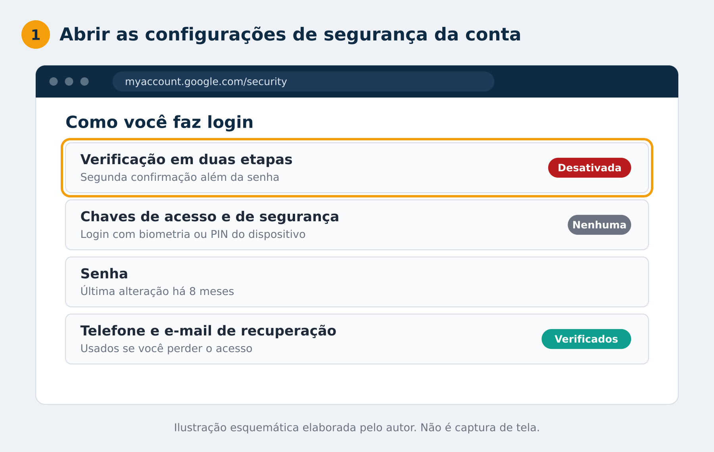
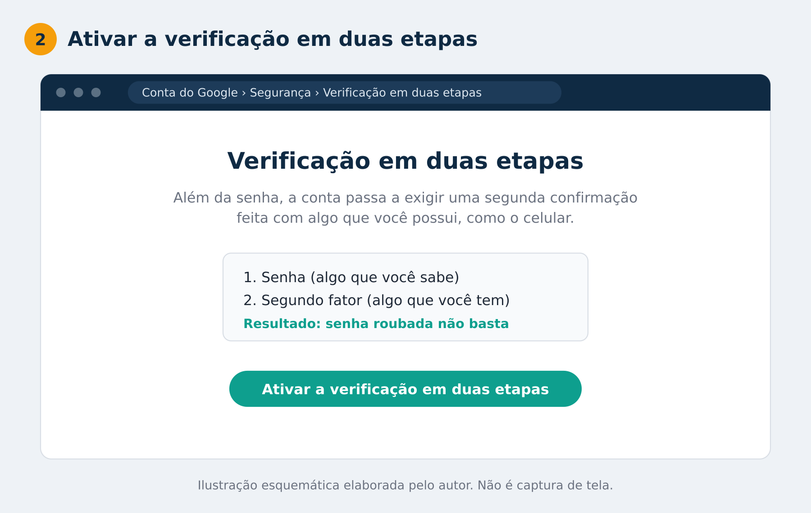
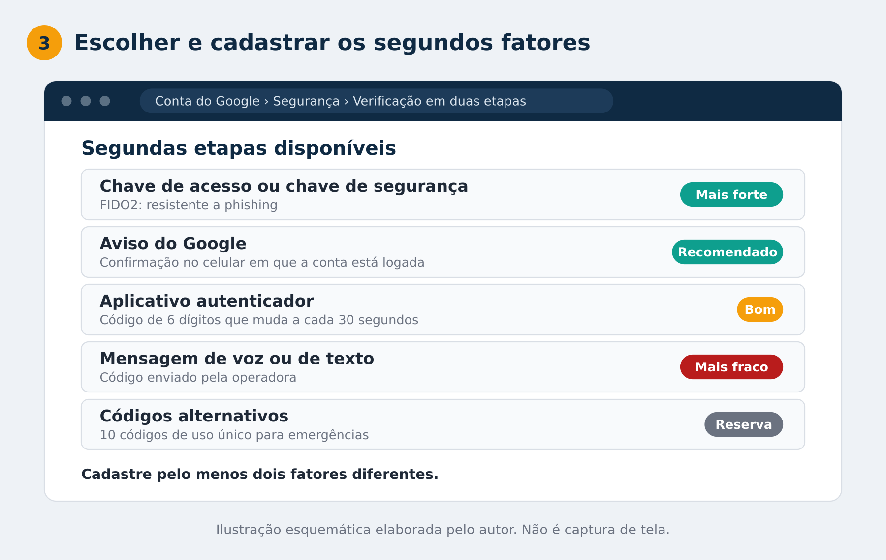
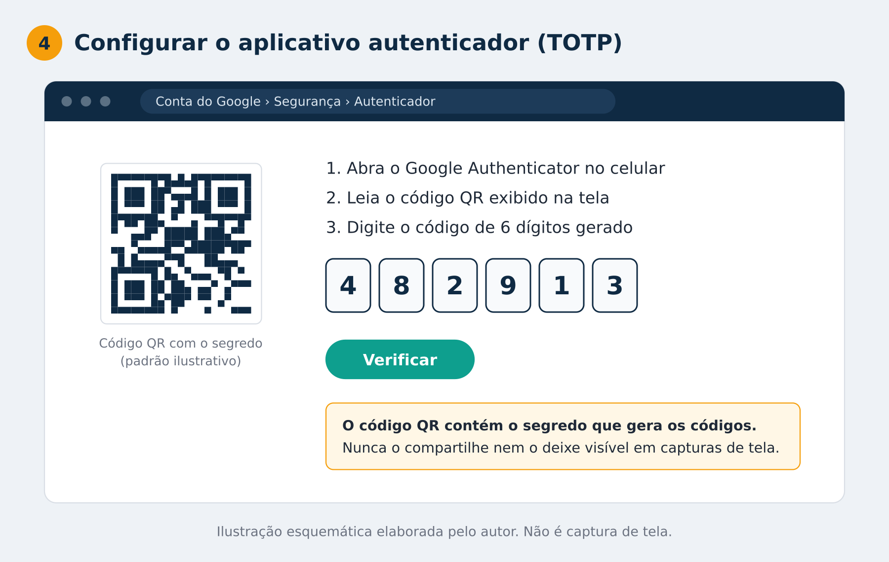
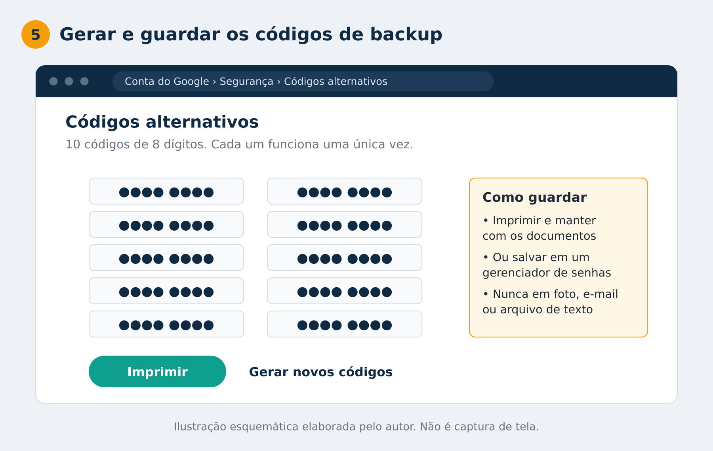
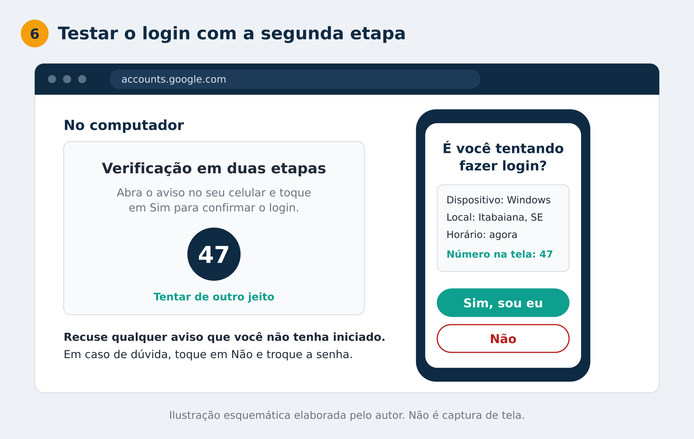

# Exemplo: ativação da verificação em duas etapas (2SV)

Passo a passo para conta pessoal e para Google Workspace. As imagens são ilustrações esquemáticas elaboradas pelo autor para representar cada etapa. Elas não são capturas de tela, e os nomes dos menus podem variar conforme a versão da interface da Google.

## Parte A: conta pessoal

### 1. Abrir as configurações de segurança

Acessar `myaccount.google.com/security` e localizar a seção **Como você faz login no Google**.

### 2. Ativar a verificação em duas etapas

Clicar em **Verificação em duas etapas**, depois em **Ativar a verificação em duas etapas**, e confirmar a senha.

### 3. Escolher e cadastrar os segundos fatores

A Google sugere primeiro o aviso no celular em que a conta já está logada. O recomendado é cadastrar pelo menos dois fatores e dar preferência aos mais fortes.

### 4. Configurar o aplicativo autenticador

Em **Autenticador**, ler o código QR com o Google Authenticator e digitar o código de 6 dígitos para confirmar.

### 5. Gerar os códigos de backup

Em **Códigos alternativos**, gerar os 10 códigos, imprimir e guardar em local seguro.

### 6. Testar o login

Abrir uma janela anônima, fazer login e confirmar que a segunda etapa é solicitada.

## Parte B: Google Workspace (administrador)

Caminho no Admin Console: **Segurança > Autenticação > Verificação em duas etapas**.

| Passo | Ação |
|---|---|
| 1 | Marcar **Permitir que os usuários ativem a verificação em duas etapas** |
| 2 | Selecionar a unidade organizacional e, em **Aplicação**, definir a data de obrigatoriedade |
| 3 | Definir o **período de adesão de novos usuários** (sugestão: 1 semana) |
| 4 | Em **Métodos**, escolher "Qualquer um, exceto códigos por SMS ou chamada" para usuários em geral |
| 5 | Escolher "Somente chave de segurança" para administradores e áreas sensíveis |
| 6 | Acompanhar a adesão em **Relatórios > Relatórios do usuário > Segurança** |

## Parte C: chaves de segurança em ambiente corporativo

Exemplo de configuração para uma empresa fictícia com 40 colaboradores.

| Item | Decisão |
|---|---|
| Quem recebe chaves | 3 superadministradores, 4 pessoas do financeiro e 2 diretores |
| Quantidade | 2 chaves por pessoa (18 no total) e 4 de estoque |
| Modelo | FIDO2 com USB-C e NFC, para uso em notebook e celular |
| Cadastro | Presencial, com a TI; números de série registrados no inventário |
| Guarda da reserva | Em casa ou em cofre da empresa, nunca junto com a principal |
| Política no Workspace | "Somente chave de segurança" na unidade organizacional desses grupos |
| Perda | Comunicar em até 24 horas; a TI remove a chave e entrega outra do estoque |
| Demais colaboradores | Aviso do Google ou chave de acesso; SMS desativado |
